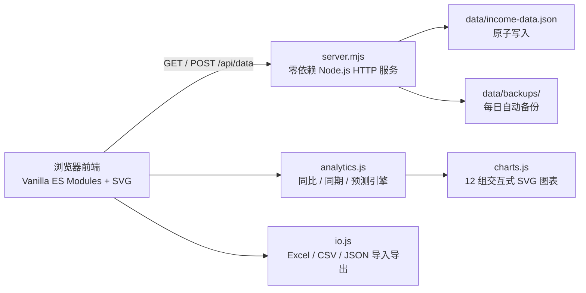

<p align="center">
  
</p>

<h1 align="center">personal-income-studio</h1>

<p align="center">
  极简美学风格的本地个人收入分析工作台，零第三方依赖，纯本地隐私存储。<br>
  开箱即用的 <strong>12 组交互式 SVG 图表</strong>、跨年公平同期对比、年度目标预测、隐私一键打码与多工作表 Excel / JSON / CSV 导入导出。
</p>

<p align="center">
  <a href="https://github.com/ljjjjj-dev/personal-income-studio/actions/workflows/ci.yml"></a>
  <a href="LICENSE"></a>
  
  
  
</p>

<p align="center">
  <a href="#功能">功能</a> •
  <a href="#五大工作台">五大工作台</a> •
  <a href="#快速开始">快速开始</a> •
  <a href="#数据与隐私">数据与隐私</a> •
  <a href="#工作原理">工作原理</a> •
  <a href="#目录结构">目录结构</a> •
  <a href="#常见问题">常见问题</a>
</p>

---

## 功能

受传统 Excel 工资表启发，但摆脱密密麻麻的公式与手动拖拽——只需按月录入或一键沿用上月常规项，所有趋势、结构与跨年同期分析自动重算：

1. **零依赖本地运行**：基于原生 Node.js 内置模块与浏览器原生 ES Modules + 手绘 SVG，无需 `npm install`，离线永久可用。
2. **Apple 极简视觉体系**：采用 macOS Sequoia 磨砂侧边栏、Apple HIG 纯色系、统一圆润柱顶与明/暗双主题无缝切换，零视觉噪音。
3. **跨年公平同期对比**：自动按「已录入月数」对齐同年同期口径（如 2026 前 10 个月 vs 2025 前 10 个月），避免全年与半年的失真对比。
4. **一键沿用 & 灵活自定义科目**：抽屉式快捷录入支持「一键沿用上月常规项」，并可随时新增/管理自定义常规项或一次性款项（区分实际到手现金与公积金入账）。
5. **一键隐私打码**：顶栏「隐私」开关即时遮蔽全部金额与文字洞察中的数字，截图或投屏时保护个人财务隐私。
6. **数据完全归你所有**：所有改动原子写入本地 `data/income-data.json` 并自动生成每日滚动备份，同时支持多 Sheet Excel（`.xls`）、CSV 与 JSON 随时导入导出。

## 五大工作台

| 工作台 | 核心能力与图表 |
|---|---|
| **总览看板** | 累计总收入 Hero 卡、年度目标进度环与全年预测、近 24 个月逐月趋势（支持切换「逐月趋势 / 现金 vs 公积金 / 累计财富滚存」）、各年同月走势对照、自然语言财务洞察 |
| **月度对比** | 同比月度并列对比、常规收入稳定性与波动区间分析、单月峰谷极值定位 |
| **收入结构** | 当年各类收入占比环形图与排序条、跨年构成演变（100% 堆叠）、各项收入跨年横向对照、现金 vs 公积金占比拆解 |
| **年度对比** | 多年度总收入 / 常规 / 一次性对比柱图、同口径增减额瀑布拆解（精确到分定位增收/减收来源）、年度汇总对比表 |
| **工资明细** | 「全部科目明细 / 精简汇总」一键切换、左右冻结列（月份与操作列常驻）、年份筛选与备注搜索、侧边抽屉快速录入与编辑 |

## 运行环境

- **Node.js 18+**（无需安装任何 npm 依赖）。
- 任意现代浏览器（Safari / Chrome / Edge / Firefox）；在 macOS 上可通过 Safari「添加到程序坞」直接作为独立桌面应用使用。

## 快速开始

```bash
git clone https://github.com/ljjjjj-dev/personal-income-studio.git
cd personal-income-studio
node server.mjs
```

启动后在浏览器访问 `http://localhost:3456`（可通过 `PORT=xxxx node server.mjs` 自定义端口）。

> [!TIP]
> 首次启动时，应用会自动加载内置的**虚拟演示数据**（[`public/app/seed.js`](public/app/seed.js)），方便立即体验全部图表与交互。你可以在界面中直接修改数据、调整科目，或通过顶栏「导入/导出」导入自己的账本。

## 数据与隐私

- **100% 纯本地运行**：服务仅监听 `127.0.0.1`，不连接任何外部 API，不上传、不统计任何个人数据。
- **原子写入 + 每日自动备份**：每次保存先写临时文件再原子重命名至 `data/income-data.json`，同时每日自动在 `data/backups/income-data-YYYY-MM-DD.json` 留存一份快照。
- **默认排除在 Git 之外**：`data/` 目录已加入 `.gitignore`，你的真实账本数据永远不会被误提交到 Git 仓库。

## 工作原理



## 目录结构

```text
personal-income-studio/
├── server.mjs               零依赖 Node.js 本地服务与原子持久化接口
├── package.json             项目元信息与内置测试脚本
├── public/
│   ├── index.html           单页应用入口
│   ├── styles.css           Apple HIG 浅色 / 深色主题与响应式布局
│   ├── manifest.webmanifest PWA 清单（支持添加到程序坞）
│   ├── icon.png             应用图标
│   └── app/
│       ├── seed.js          默认科目定义与虚拟演示数据
│       ├── io.js            本地存储同步、版本迁移与 Excel/CSV/JSON 导入导出
│       ├── analytics.js     财务统计、公平同期对比、年度预测与自然语言洞察
│       ├── charts.js        12 组交互式 SVG 图表渲染器
│       └── main.js          五大工作台视图、录入抽屉、科目管理与隐私模式
├── tests/
│   └── analytics.test.mjs   核心计算与数据迁移单元测试（node:test）
├── icon/                    项目图标资源
└── data/                    用户本地账本与每日备份（已 gitignore）
```

## 常见问题

- **端口 `3456` 被占用**：启动时指定其他端口即可，例如 `PORT=3500 node server.mjs`。
- **想清空演示数据从零开始**：在「工资明细」编辑或直接导出 JSON、清空 `records` 中的 `values` 后再重新导入即可；也可按需在「科目」弹窗中增删适合自己的收入项。
- **如何运行单元测试**：直接执行 `npm test`（调用 Node 内置 `node:test`，无需安装任何测试框架）。

## 声明

- 本仓库内置的全部初始化金额、月份与备注均为**虚构演示数据**，不代表任何真实个人或机构信息。
- 本项目仅作个人收支记录与可视化参考工具，不构成税务或财务建议。

## 维护与致谢

- 界面架构、SVG 图表引擎、财务同期分析模型与本地服务由 **Antigravity** 协助构建与迭代。

## 许可证

[MIT](LICENSE)
